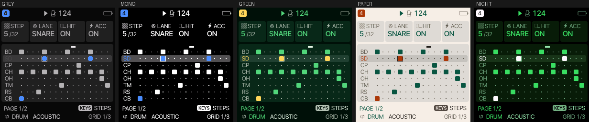
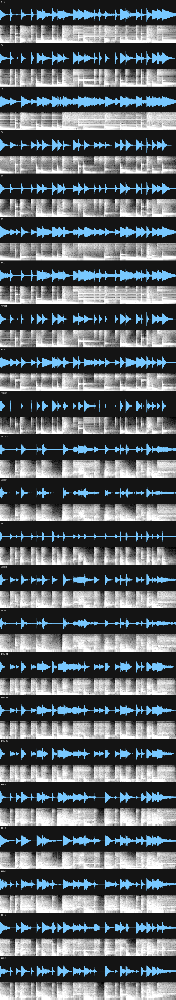
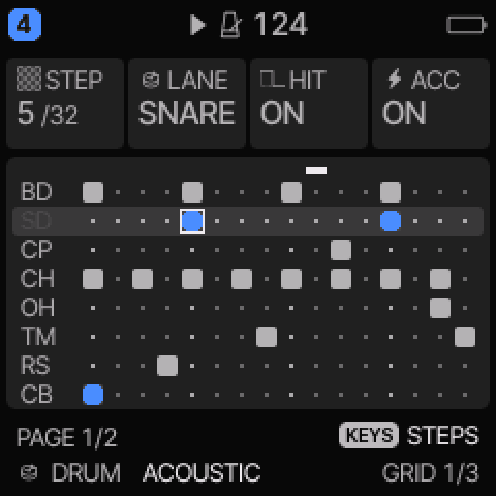
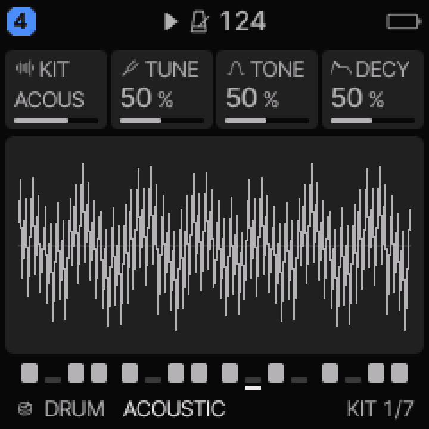
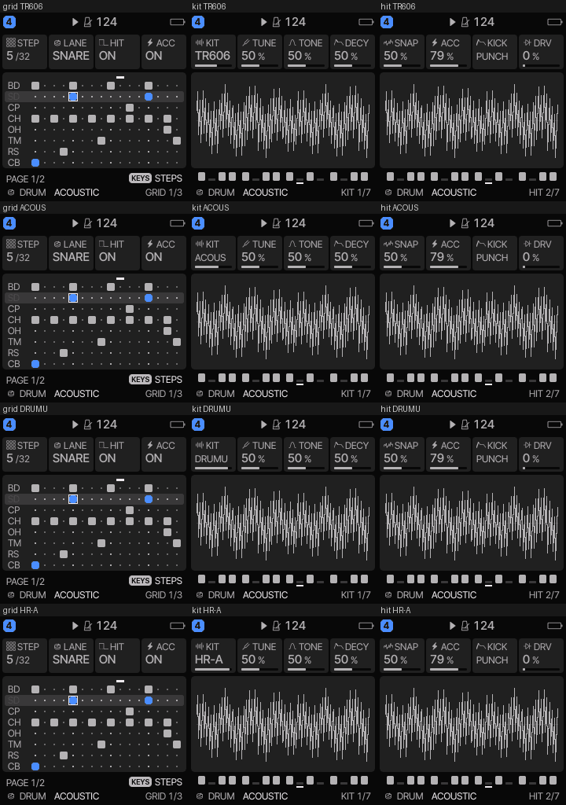
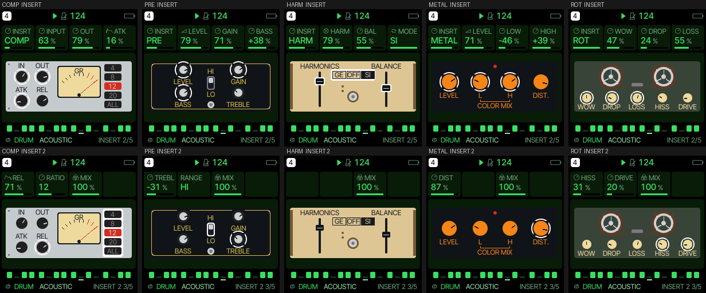

# Roland: drum machine firmware for the M-VAVE FM-1

*The name is a nod to Steve Albini's Big Black, whose records credit their drummer as "Roland": a Roland TR-606 drum
machine.*

*(Steve Albini would hate this, of course. Everything new in this repository, the code changes and every word of this README,
was written by an AI model, and it shows: status tables, a "read this first" section, a disclaimer for every occasion, a
"What this is not" for good measure. It is, in short, digital, corporate-advisory, AI-generated slop wrapped around a drum
machine, which is about as far from two people in a room with a Roland and a bad PA as you can get. The parts that were
made by actual people (Felucca, SLOOP, the recordings) are credited below, and deserve better.)*

<p align="center"></p>
<p align="center"><sub>The 8-lane drum grid on a TR-606 kit, drawn by the firmware's own UI code in its five colour schemes
(host render: the real screen code on a test display, not a photo of the FM-1).</sub></p>

Drum-only firmware for the M-VAVE FM-1, built on [Felucca](https://github.com/hugelton/Felucca) (GPL-3.0-only). It keeps
Felucca's drum engine and its sequencer and offers nothing else: four drum tracks, each with its own pattern, and a choice of

* **synthesized kits** (Felucca's own DRUM engine: DRUM, DEEP, TIGHT, PERC and the 80 / 10 / 66 / 55 / 77 machine kits),
* **a TR-606 kit** (`TR606`), SLOOP's synthesized TR-606,
* **SLOOP's acoustic drum set** (`ACOUS`, `AC-DP`, `AC-TI`, `AC-BR`, `AC-DU`): real drum recordings in five treatments,
* **E-mu Drumulator kits** (`DRMU1`, `DRMU2`, `DRMU3`), made from the twelve Drumulator sounds you supply, and
* **Alesis HR-16B sample kits** (`HR-A`, `HR-B`, ...), built from the WAV files of the
  [Cluster Sound HR-16B freebie](https://clustersound.com/product/freebies/hr-16b/).

All of them are KIT values of the same DRUM engine, so they share the 8-lane grid (KICK SNARE CLAP HATCL HATOP TOM RIM
BELL), the lane mutes and levels, ratchets, chance, conditions, parameter locks, song chaining and MIDI. Any track can
use any kit, so a synthesized kick can play under HR-16 hats.

## Listen

Each clip is the same two-bar GM beat (kick, snare, claps, closed and open hats, toms, rim, cowbell, a crash), 4 seconds,
rendered by the firmware's own engine, mixer and effects on a PC (so no FM-1 speaker, and no knob moves). Click a link, then
the download or "view raw" button. All mono mp3.

| Kit | What it is | Clip |
|---|---|---|
| `STD` | Felucca's own synthesized kit (the power-on kit) | [kit_00_STD.mp3](docs/audio/kit_00_STD.mp3) |
| `80` `10` `66` `55` `77` | Felucca's five model kits | [80](docs/audio/kit_04_80.mp3) · [10](docs/audio/kit_05_10.mp3) · [66](docs/audio/kit_06_66.mp3) · [55](docs/audio/kit_07_55.mp3) · [77](docs/audio/kit_08_77.mp3) |
| `DEEP` `TIGHT` `PERC` | Felucca's kits put together from the model kits' pieces | [DEEP](docs/audio/kit_09_DEEP.mp3) · [TIGHT](docs/audio/kit_10_TIGHT.mp3) · [PERC](docs/audio/kit_11_PERC.mp3) |
| `TR606` | SLOOP's synthesized TR-606 (hats of about 35 and 220 ms, a crash of about 0.7 s) | [kit_12_TR606.mp3](docs/audio/kit_12_TR606.mp3) |
| `TR606` + COMP | the same beat through the INSERT's COMP (INPUT 100, OUT 80, fast attack, 12:1): level pulled together, the clicks of the kick and hats still get through | [insert_comp_TR606.mp3](docs/audio/insert_comp_TR606.mp3) |
| `TR606` + METAL | the same beat through the INSERT's METAL, the HM-2 model (LEVEL 70, DIST 50): note the gate cutting the tails | [insert_metal_TR606.mp3](docs/audio/insert_metal_TR606.mp3) |
| `TR606` + HARM | the same beat through the INSERT's HARM, the Percolator model (HARMONICS 100, BALANCE 90, MODE GE) | [insert_harm_TR606.mp3](docs/audio/insert_harm_TR606.mp3) |
| `TR606` + PRE | the same beat through the INSERT's PRE, the Surveyor-style preamp on the IVP's signal path (GAIN 50, BASS +20, TREBLE +10) | [insert_pre_TR606.mp3](docs/audio/insert_pre_TR606.mp3) |
| `TR606` + ROT | the same beat through the INSERT's ROT (wow 60, dropouts 40, loss 70, hiss 50, drive 30): a worn tape | [insert_rot_TR606.mp3](docs/audio/insert_rot_TR606.mp3) |
| `TR606` + tape delay | the same beat with the delay send up (80): the repeats wobble a little in pitch, darken and soften as they go round | [insert_tape_delay_TR606.mp3](docs/audio/insert_tape_delay_TR606.mp3) |
| `ACOUS` | SLOOP's acoustic kit as recorded | [kit_13_ACOUS.mp3](docs/audio/kit_13_ACOUS.mp3) |
| `AC-DP` | the same, pitched down and softened | [kit_14_AC-DP.mp3](docs/audio/kit_14_AC-DP.mp3) |
| `AC-TI` | the same with a quick decay | [kit_15_AC-TI.mp3](docs/audio/kit_15_AC-TI.mp3) |
| `AC-BR` | the same, pitched up 2 semitones | [kit_16_AC-BR.mp3](docs/audio/kit_16_AC-BR.mp3) |
| `AC-DU` | the same, down a semitone, darker and 8-bit | [kit_17_AC-DU.mp3](docs/audio/kit_17_AC-DU.mp3) |
| `DRMU1` `DRMU2` `DRMU3` | the Drumulator kits | *no clips: the licence of that pack is not known to me, so its sounds are not published here* |
| `HR-A` `HR-B` ... | the HR-16B kits | *no clips: that pack's licence is not known to me, so its sounds are not published here* |

<p align="center"></p>
<p align="center"><sub>Each kit playing the same beat: waveform on top, spectrogram (frequency on a log scale) below.</sub></p>

## Pictures

<p align="center">
  
  
</p>
<p align="center"><sub>Left: the drum grid (BD SD CP CH OH TM RS CB). Right: the KIT page of the ACOUS kit. The picture in the
middle of the KIT page is the test display's stand-in signal, not the sound. The row at the bottom says ACOUSTIC because it
is the track's preset, and the host render sets the kit directly.</sub></p>

<p align="center"></p>
<p align="center"><sub>The grid, KIT and HIT pages for TR606, ACOUS, AC-DU and HR-A: the new kit names fit the screen.</sub></p>

## The INSERT's devices

<p align="center"></p>
<p align="center"><sub>Top row: the INSERT page of COMP, PRE, HARM, METAL and ROT. Bottom row: INSERT 2 (the fourth and fifth control, and
MIX). The ring marks the controls the open page turns. The bodies keep the devices' paint on every colour palette, and turn
to their grays on GREY and MONO.</sub></p>

The INSERT page draws each effect as the box it models, with its own controls where the box has them, turned to the track's
values (`overlay/firmware/src/ui_faces.c`; no maker's name or logo is drawn):

| Type | Modelled on | Controls (the knobs' order) |
|---|---|---|
| COMP | a 1176-style limiting amplifier (rack) | INPUT, OUT, ATK, REL, RATIO 4 / 8 / 12 / 20 / ALL; the gain-reduction meter |
| PRE | the Surveyor-style preamp pedal (the Intersound preamp's family) | LEVEL, GAIN, BASS, TREBLE (cut / boost around noon), HI / LO switch |
| HARM | the Harmonic Percolator | HARMONICS and BALANCE sliders, MODE (GE, OFF, SI: the clipping diodes) |
| METAL | the HM-2 | LEVEL, LOW and HIGH (the COLOR MIX pair, around noon), DIST |
| ROT | a worn reel-to-reel tape | WOW, DROP (dropouts), LOSS (lost highs), HISS, DRIVE; the reels turn while the song plays |

INSERT has the values A to E (`P_IA .. P_IC`, and the two the drum machine added, `P_ID` and `P_IE`); a type names the ones it
has and shows "-" for the rest. **Every INSERT type works now (steps 3 and 4: a fixed-point peak compressor in the log domain, `overlay/firmware/src/fx_comp.c`, checked by `tests/test_comp.py`: the static curve within 1.2 dB, the attack and release times, the ratios; ROT in `fx_rot.c`, checked by `tests/test_rot.py`), and COMP's meter moves; METAL, in `fx_hm2.c`, is a model fitted to a SPICE netlist of the HM-2 circuit (`tools/fxlab/spice/`), checked by `tests/test_hm2.py`: gain, the lopsided clip and its second harmonic, the gate, the three tone bands). HARM, in `fx_perc.c`, is fitted to a SPICE netlist of the Percolator (Albini values; `tests/test_perc.py`: the pot's gain and low cut, the lopsided clip, the three diode modes; the Ge diodes' knee at a few millivolts is not modelled). PRE, in `fx_ivp.c`, follows the IVP's own signal path (`tools/fxlab/spice/ivp.py`: the Baxandall stage and the TUBE DRIVE stage with its transistor pair; the parametric bands stay flat and the transformer is not modelled; `tests/test_ivp.py`).** Projects and presets that were
saved before load with D 64 and E 0 (the format maps by count, no version change).

## Status: read this first

| | |
|---|---|
| Firmware sources (`patches/felucca-drum.patch`) | **Compile and run on the host** (`./host_render.sh`, below): the patched engine, the ported SLOOP synth and the sample player build with gcc through Felucca's own test harness, and every kit renders. **Not built for the FM-1**: the JieLi toolchain could not be fetched, so there is no `.fwsc`. Expect the unexpected there (flash size, the audio interrupt's CPU budget). |
| On the FM-1 | **Not tested.** Installing firmware is at your own risk; Felucca's installer offers a way back to the official firmware, and recovery from a failed install needs [FM-1-transporter](https://github.com/kurogedelic/FM-1-transporter). |
| Sound | **Not heard by me.** The clips and charts are the engine's real output, and I checked levels, lengths, pitches and clipping numerically, but nobody has listened critically, and the FM-1's own speaker and codec are not in the loop. |
| Sample importer (`overlay/tools/gen_hr16.py`) | **Tested**: 13 tests on synthetic WAVs and on the bundled recordings, including a gcc build of the generated header, a bit-exact check of the firmware's ADPCM decode against the generator's, and the budget logic. |
| TR606 kit | SLOOP's synth code compiles warning-free and all 16 sounds render, end and choke (`tests/test_tr606.py`); not compared with SLOOP's own output. Its level against Felucca's kits is a guess (`TR606_GAIN_DB`, default -3). |
| Acoustic kit | The sample player and its five treatments are cut out of the patch, compiled and run on the real recordings (`tests/test_acoustic.py`). |
| Drumulator sounds | **Not included** (git-ignored; `assets/drumulator/`). Tested with the pack you supplied: its twelve sounds (the 16k set, 15,625 Hz) make three kits, all render at about the level of the synthesized kits with no clipping. Not heard. |
| HR-16B samples | **Not included** (git-ignored). The importer was run on the Cluster Sound *Ableton Live* edition (`CS-HR-16B-Live.zip`, the WAVs in its `HR-16B/Samples/` folder, names like `cs_big_foot_kk.wav`): 47 files, 37 sorted into lanes. Other editions may name files differently: run `--list` and check. The 10 FX hits (bottles, pipe, ...) are not used. |
| Flash size | **Unknown.** The 192 KiB sample budget (`HR16_BUDGET`) for all sample kits together is a guess about what fits beside Felucca; the build's linker check will tell, and HR-16 kits are dropped first to fit. Felucca's CC0 piano/flute/sax, the SLICE engine and now every other engine are dropped to make room (about 99 KB in the host
measurement), so there is probably more room than the budget assumes: raise `HR16_BUDGET` once the real build says what is left. |

## Host render: what the firmware sources do (no FM-1 needed)

`./host_render.sh` builds the **same patched firmware sources** for the host with gcc (Felucca's own test harness: the real
engines, voices, mixer, FX, sequencer and UI code on a stub display) and captures what they do. It clones Felucca, applies
the patch, generates the tables, compiles, and writes `out/host/`: a WAV and an mp3 per kit, all kits in one file, the screens
as PNGs, and the charts above (`PUBLISH=1` also copies the shareable ones into `docs/`). About 40 seconds.

* **The whole firmware type-checks**, every file that ships (`felucca.c`), with `FELUCCA_DRUMONLY=0` and `=1`, and the test
  harness builds. With `FELUCCA_DRUMONLY=1 FELUCCA_SLICE=0 FELUCCA_TR606=1 FELUCCA_ACOUSTIC=1 FELUCCA_HR16=1` the only
  warnings are Felucca's (two unused variables with SLICE off, 64-bit pointer casts in the hardware layer).
* **All the kits render** (18 with the three HR-16 ones; 21 KIT values, 3 of them retired aliases) a two-bar GM beat through
  the real mixer and FX with **no clipped sample** ([levels](docs/host-render/kit_levels.txt)). Synthesized kits sit at
  3.7-5.1 k RMS (TR606 3.7 k at the default -3 dB); the acoustic kits are quieter, 2.0-2.8 k, the HR-16 ones
  3.7-3.9 k. The acoustic kits could take about 3-5 dB more (`PEAK` in `gen_hr16.py`); not changed without listening.
* **Felucca's UI lint passes** on the patched build: 233 screens x 10 palettes, 0 layout findings, 0 alignment errors
  ([log](docs/host-render/ui_lint.txt)).

* **Removing the other engines and the effects above saves about 107 KB of code and read-only data** (689,228 to 582,344
  bytes, 15%, with the sample kits in) on the same
  tree, by the host compiler at `-Os` ([`tests/host_size.sh`](tests/host_size.sh), `out/host/size.txt`). That is x86-64 code,
  which is bulkier than the FM-1's, so read it as the size of the difference in kind, not as a number of kilobytes on the
  device. It includes 22 KB of sample-loop data that only the removed SLICE engine used. The audio of every kit is
  **bit-for-bit identical** before and after the removal, and every screen picture in `docs/` is byte-identical too.
  RAM (data and bss) is 29 KB lower. Not touched: the 4 x 12.9 KB engine memory pool (RAM, sized for the largest removed
  engine; the DRUM engine needs far less).

This says nothing about the FM-1's own CPU budget (the render is faster than real time on a PC), flash size, or how it
sounds on the speaker.

## Build

You need what Felucca's [BUILDING.md](https://github.com/hugelton/Felucca/blob/main/BUILDING.md) lists: Python 3 with
Pillow and fonttools, the JieLi toolchain (`tools/get_toolchain.sh` in Felucca) and the AC79 SDK (Linux x86-64 runs it
natively, otherwise Docker).

1. Optional: put the twelve Drumulator WAV files in `assets/drumulator/` (see the README there; the `...-16k.wav` set is used
   when it is there) and download the HR-16B pack and put its WAV files in `assets/hr16/` (for the Live edition: everything in
   `HR-16B/Samples/`, not the `.adg` or `.asd` files). They are git-ignored; check the pack's licence before you share an
   image that contains them.
2. Check how the files will be sorted into lanes:
   ```
   python3 overlay/tools/gen_hr16.py --list assets/hr16
   ```
   If a lane is empty or a file is in the wrong one, write a map (format in the script's docstring) and set `HR16_MAP`.
3. Build:
   ```
   ./build_drum.sh            # -> out/roland-drum.fwsc
   ```
   It clones Felucca at the pinned commit, applies the patch, copies `overlay/`, and runs Felucca's own `build.sh` with
   `FELUCCA_DRUMONLY=1 FELUCCA_SLICE=0 FELUCCA_TR606=1 FELUCCA_ACOUSTIC=1 FELUCCA_HR16=1`. With no HR-16 or Drumulator WAV files it
   builds without those kits; `FELUCCA_TR606=0` and `FELUCCA_ACOUSTIC=0` leave those kits out.
4. Install as Felucca's BUILDING.md describes (`tools/fm1_install.py out/roland-drum.fwsc`, or a local copy of its web
   installer).

Tests: `python3 -I tests/test_gen_hr16.py`, `tests/test_tr606.py` and `tests/test_acoustic.py` (34 tests; need `gcc`; `tests/test_fxlab.py` checks the effects' component values against the documents).

## What changed from Felucca

* `FELUCCA_DRUMONLY=1`: **the only engine is DRUM.** The other engines (ANALOG, PHASE, LOFI, SAMPLE, VOICE, TRIO, WHEEL,
  GRAIN, PHYS, NOISE, FM6, and DIGITAL's conversion) are not built: their code, tables, factory sounds and their own screens
  (FM6's operator pages and algorithm charts, WHEEL's drawbars, SAMPLE's waveform) are left out to save flash. **What stays:**
  everything that is not an engine or one of the effects removed below: the delay and reverb sends, the modulation matrix,
  LFOs, the arpeggiator, the sequencer, songs, projects, MIDI, USB audio and the editor. Engine numbers keep their
  slots in the table and every one of them plays DRUM, so a project, preset or backup that names another engine loads as
  drums. The records that held other engines' data (a project's FM6 patches, an undo step, a backup's FM6 and sample-slot
  sections) keep their layout, so what is already in flash still loads; the data is ignored, and the editor's sample-slot
  commands answer "no such slot". `overlay/firmware/src/drum_gone.c` is the small stand-in for what the remaining code still
  names. Power-on: DRUM KIT, TR-606, TIGHT KIT, and the acoustic kit on track 4.
* **Effects, step 1 of [the FX plan](docs/FX-PLAN.md)** (`FELUCCA_DRUMONLY=1`): removed are the per-track **DIST**, the
  **SLICER**, the **chorus** (its send, its buffer and its page), the old **INSERT types** (soft, hard, fold, fuzz, crush,
  phaser, flanger, chorus) and the FX layer's **FLANGER** and **PHASER** (their keys are free). The INSERT slot stays, with
  only OFF in it for now: the new effect pool goes there. The delay and reverb sends stay until their replacements (tape
  delay, the Dragonfly room) are in. With these effects at their defaults the audio of every kit is **bit-for-bit identical**
  to before; the FX page shows DLY and REV only. Stored values keep their ids (a project with a DIST amount loads, and the
  amount is ignored). The modulation matrix's DIST and CHO destinations are retired the same way (they load as OFF).
* **The delay is a tape echo** (FX plan step 3, `overlay/firmware/src/fx_tape.c`): the read head wanders (wow about 0.2 % of pitch, flutter
  0.05 %), what goes onto the tape is soft-clipped, and each repeat goes through the COLR low-pass as before. TIME, FDBK, COLR and MIX
  keep their meaning; ECHO THROW and the tempo-synced times work as they did. `tests/test_tape.py` checks the wander and the tap.
* `FELUCCA_HR16=1`: KIT values `HR-A`.. appended after PERC. A hit plays one IMA ADPCM sample per lane, resampled by
  **TUNE**; **DECY** below 64 shortens it, **TONE** below 64 darkens it, **DRV** distorts it; the closed hat chokes the open
  hat. **SNAP, KICK and ACC do nothing** on a sample kit. Level and accent come from velocity. GM notes keep Felucca's
  pitch offsets, so one tom sample plays all the toms.
* `FELUCCA_TR606=1`: KIT value `TR606` and a `TR-606` preset. The sounds, the synth that plays them and the kick tuning for
  small speakers are [SLOOP's](https://github.com/isod89/sloop-fm1) (GPL-3.0; thanks to isod89), ported to Felucca's DRUM
  engine: SLOOP's 808 kit with the 606's changes (kick, snare, hats, toms, cymbal). A TR-606 has no clap, rim, conga,
  cowbell or clave: SLOOP's 606 keeps the 808's behind the GM notes that ask for them. Each GM note plays SLOOP's own sound
  for it (16 sounds, so the congas, ride, shaker and clave are there), on the nearest of the 8 lanes. **TUNE** moves the
  pitch, **DECY** the decays (per hit, -4..+3 steps), **DRV** works; **TONE, SNAP, KICK and ACC do nothing** on it. The closed
  hat chokes the open hat.
* `FELUCCA_ACOUSTIC=1`: SLOOP's acoustic drum set, as five KIT values over one set of 8 recordings. The recordings are
  [VCSL](https://github.com/sgossner/VCSL) (Versilian Studios, CC0 1.0) in the cut, normalised mono versions SLOOP made;
  they are in `assets/acoustic/` with their attribution. The treatments are SLOOP's: `ACOUS` as recorded; `AC-DP` pitched
  down (5 semitones on the kick, 2 elsewhere) and softened; `AC-TI` with a quick decay; `AC-BR` up 2 semitones; `AC-DU`
  down 1 semitone, darker and 8-bit. The kick and toms get SLOOP's shorter body, the cymbals its 0.6 s with a fade, and the
  hats and cymbal keep a 32 kHz rate. **The 8 lanes carry one sample each**, so SLOOP's separate hi tom, ride, cowbell,
  conga, shaker, claves and tambourine are not in it: the TOM lane has the low tom (the other toms are its pitches), and
  the BELL lane the crash. Same knobs as the HR-16 kits.
* **`DRMU1`..`DRMU3`, the E-mu Drumulator**: its twelve sounds (bass drum, snare, clap, closed and open hat, three toms,
  rim, clave, cow bell, cymbal) on eight lanes, so three kits share them: the same bass drum, snare, claps and hats, and
  `DRMU1` mid tom, rim, cow bell; `DRMU2` lo tom, clave, cymbal; `DRMU3` hi tom, rim, cymbal. The importer finds the files by
  name and uses the `-16k` set at its own 15,625 Hz (the sounds are short, 24,416 bytes of ADPCM in all). The sounds are
  taken as they are in the files: they are not literally 8-bit there (normalised and resampled), so nothing 8-bit is
  added. Same knobs as the other sample kits. The sounds are not in this repository.
* ADPCM sample kits are mono, trimmed, normalised per lane and stored at 22.05 kHz (`HR16_RATE`; the Drumulator ones at
  their own rate), one-shot.
* The other build modes are untouched: with `FELUCCA_DRUMONLY=0` the firmware is Felucca's, and the whole tree type-checks
  in both modes (`tests/host_size.sh`).

Kit k of the HR-16 pack takes the k-th file of each lane (wrapping), up to `HR16_MAX_KITS` (6). All sample kits share
`HR16_BUDGET` (192 KiB by default; the other engines' removal made room, but the real build has not said how much). The order
is acoustic, Drumulator, HR-16; the acoustic kit is never dropped (about 50 KiB), the Drumulator ones take about 24 KiB, and kits
are dropped from the end to fit: HR-16 kits first (the five that fit with the rest take about 112 KiB), then the Drumulator ones.

## Credits

[Felucca](https://github.com/hugelton/Felucca) by Leo Kuroshita / Hügelton Instruments; [SLOOP](https://github.com/isod89/sloop-fm1)
by isod89 (the TR-606 kit and the synth that plays it, the acoustic kit and its treatments);
the acoustic recordings are Versilian Studios' VCSL (CC0); the Alesis HR-16B samples are Cluster Sound's; the Drumulator
sounds are as you supplied them ("drm-EMU Drumulator"; I do not know who made that set of files).

## Licence

GPL-3.0-only, as Felucca; see `LICENSE`. The patch is a derivative of Felucca. Felucca's engines and hardware layer
keep their own licences ([LICENSING.md](https://github.com/hugelton/Felucca/blob/main/LICENSING.md)). M-VAVE, FM-1, Alesis,
Roland (TR-606), E-mu and Drumulator are trademarks of their owners; this project is not affiliated with them or with Felucca's or SLOOP's
authors.
